# CullThing

**From memory card to selects, edits, and Lightroom.**

CullThing is a desktop app for photographers working through large RAW shoots. Review photos by scene, find your keepers, prepare Remove adjustments, and give a whole shoot a starting edit with EditThing.

**[Visit the CullThing website](https://andrei930.github.io/cullthing-releases/)** · [Latest release & notes](https://github.com/andrei930/cullthing-releases/releases/latest) · [Report an issue](https://github.com/andrei930/cullthing-releases/issues)

## Download and install

**Current release: [CullThing v0.9.12](https://github.com/andrei930/cullthing-releases/releases/latest)**

| Platform    | Download installer                                                                                                                              | Requirements                             |
| ----------- | ----------------------------------------------------------------------------------------------------------------------------------------------- | ---------------------------------------- |
| **macOS**   | **[Download for Mac (.dmg)](https://github.com/andrei930/cullthing-releases/releases/download/app-v0.9.12/CullThing_0.9.12_aarch64.dmg)**       | Apple Silicon (M1 or newer), macOS 13.4+ |
| **Windows** | **[Download for Windows (.exe)](https://github.com/andrei930/cullthing-releases/releases/download/app-v0.9.12/CullThing_0.9.12_x64-setup.exe)** | 64-bit Intel/AMD                         |

On Mac, you can also use the **[one-command installer](#quick-install-with-terminal)** to download and install the app. It handles the first-launch quarantine step for you.

These links download the installer files directly. [Browse the latest release](https://github.com/andrei930/cullthing-releases/releases/latest) for all files and release notes. Intel Mac and Windows ARM builds are not currently provided.

1. **Download** the installer for your computer.
2. **Install** using the [macOS instructions](#installing-on-macos) or [Windows instructions](#installing-on-windows) below. Current test builds may show an operating-system security warning; the steps below explain what to expect.
3. **Launch CullThing**, then open a folder of photos to start culling, or choose **EditThing** on the home screen to set up an editing profile.

Already installed? Use **Check for Updates…** in the application menu.

Files ending in `.app.tar.gz`, `.sig`, and `latest.json` belong to the updater, not a normal installation. Download only from this official repository or a link supplied directly by the developer. Draft releases are still being tested.

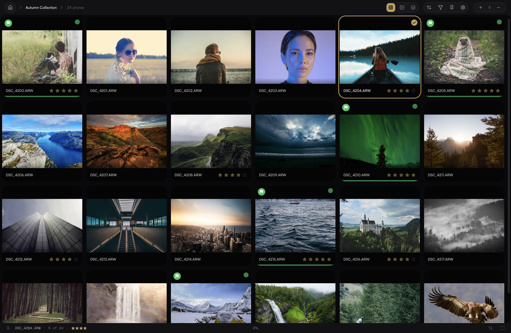

_The real CullThing interface with sample photos and illustrative data. No personal photo library is shown._

## More than culling

- **Review your way.** Switch between a photo grid, scenes, and a single-image view. Navigate with the keyboard, compare similar frames, and inspect faces, focus, and eye status.
- **Make your selects.** Use star ratings, color labels, pick/reject flags, filters, and sorting. Find a specific file with **⌘F / Ctrl+F**. Keep culling decisions alongside your photos in XMP sidecars.
- **Crop, straighten, and expand.** Set framing and leveling with XMP adjustments, or use **Generative Expand** to prepare a DNG copy with a larger frame. Lightroom generates the new edges.
- **Prepare removals.** Brush over distractions in **Remove mode**, use auto-mark suggestions, copy marks between photos, and group touching marks into one removal. CullThing saves Lightroom-compatible AI-update instructions; **Lightroom Classic generates the removal result**.
- **Edit a shoot with EditThing.** Start from a Lightroom preset with an **Instant** profile, or train a **Personal** profile from your own edited photos. Try a profile on a few images, apply it across a shoot, adjust its behavior, and undo an edit run.
- **Bring in your cards.** **Card Manager** lets you review and copy photos from memory cards to your chosen destinations.
- **Cull from another device.** Enable **Remote Access** on the desktop, then pair a phone or tablet on the same network to review a project or the library in its browser.
- **Continue in Lightroom Classic.** Carry ratings, labels, crops, and Remove instructions through XMP. EditThing can write develop settings to sidecars or work with an open catalog through the included Lightroom Classic plug-in.

## Clean up as you cull

**Remove mode lets you prepare distractions for removal while you are already reviewing the shoot.** Brush over a stray cable, sign, or other unwanted object, then move straight to the next frame. CullThing saves the marks as Lightroom-compatible AI-update instructions; Lightroom Classic generates the actual removal when you update AI settings.

- **Spot it once, mark it now.** Keep your filmstrip available so cleanup preparation stays part of the culling pass, without reopening every keeper later just to find the same distractions.
- **Reuse the work.** Copy and paste marks between similarly framed photos, then refine them. Group strokes that describe one object into a single removal.
- **Let auto-mark do the first pass.** Choose common distractions such as wires, exit signs, or background cars, or describe an object. Review the suggested marks and accept the ones you want.
- **Keep your hands moving.** Pan, brush, erase, and resize with configurable modifiers, the wheel, or shortcuts, with fewer trips to the toolbar.

You spend less time repeating selection work and switching between culling and cleanup. The original RAW stays intact; Lightroom remains the place to review and generate the final result.

## A visual tour

Screenshots show the real interface with sample photos, neutral project names, and illustrative analysis and Lightroom feedback data. They demonstrate the controls, not measured analysis results for these sample photos.

<details open>
<summary><strong>Review and arrange your workspace</strong></summary>

Pick a layout for the way you review. Keep the controls within reach, inspect the details, or clear the screen for the photograph.

### A filmstrip beside the photograph

Keep neighboring frames in a vertical filmstrip, with the floating rating and flag bar centered beneath the photograph. Floating navigation arrows are off for this desktop layout.

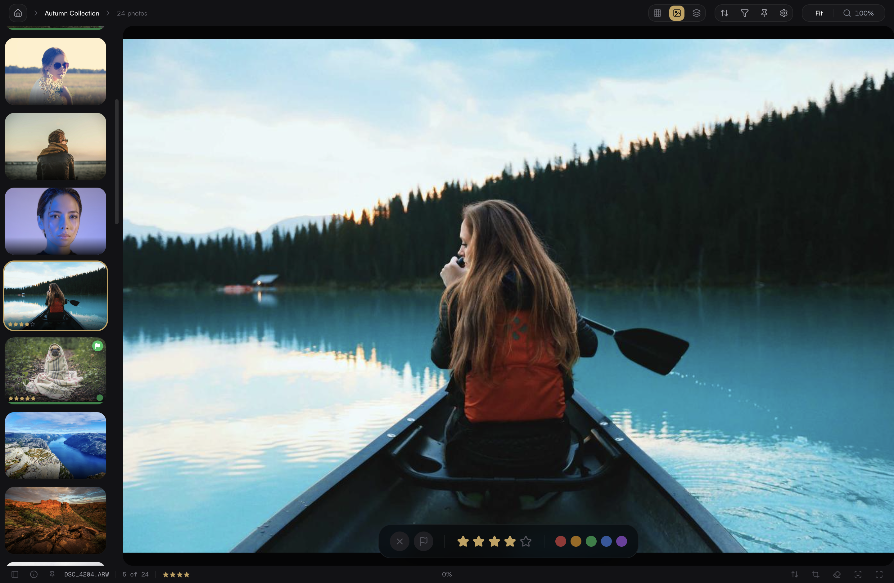

### A filmstrip below the photograph

Switch to a horizontal filmstrip. This view has the floating action bar and navigation buttons switched off, leaving the image clear.

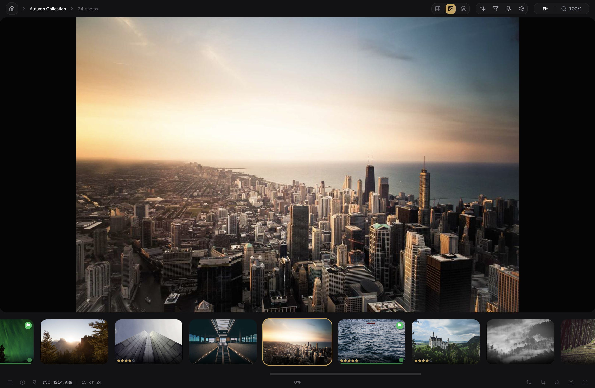

### Review one scene at a time

The scene navigator groups the shoot into moments; the neighboring strip shows the frames in the selected scene. Move between moments without losing your place.

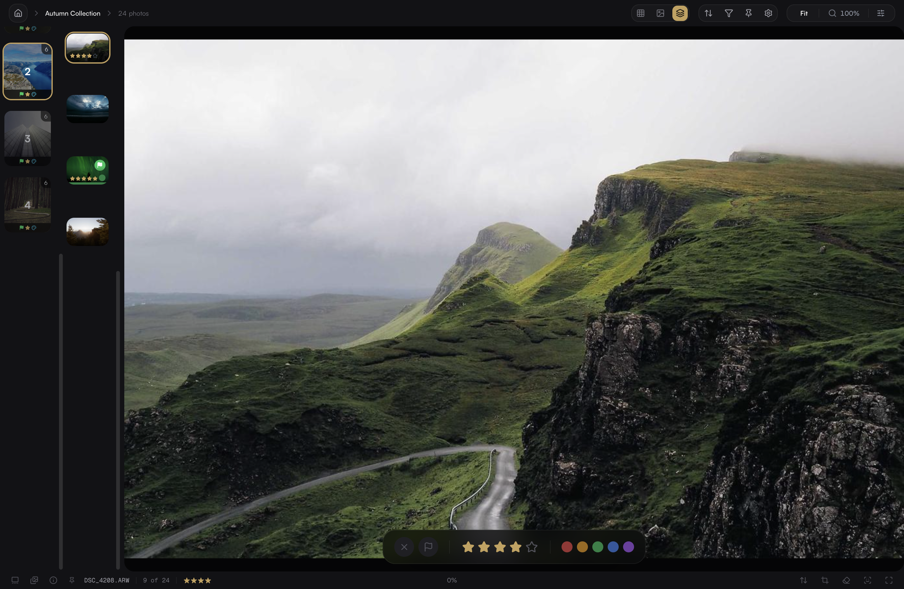

### Faces, focus, eyes, and the shot details

Inspect the magnified face panel, the focus score, and eye status together. The info panel on the opposite side shows ratings, labels, camera, lens, exposure, and capture information. Eye status appears after Analyze Eyes.

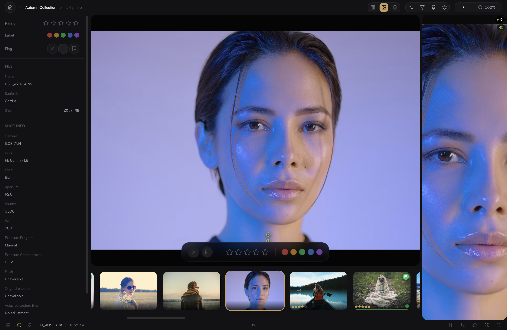

### Put each panel where it works for you

Dock the filmstrip left, right, or along the bottom. Move the scene navigator, face panel, and info panel to either side. Center the floating action bar or hide it; navigation arrows can be enabled when using a tablet.

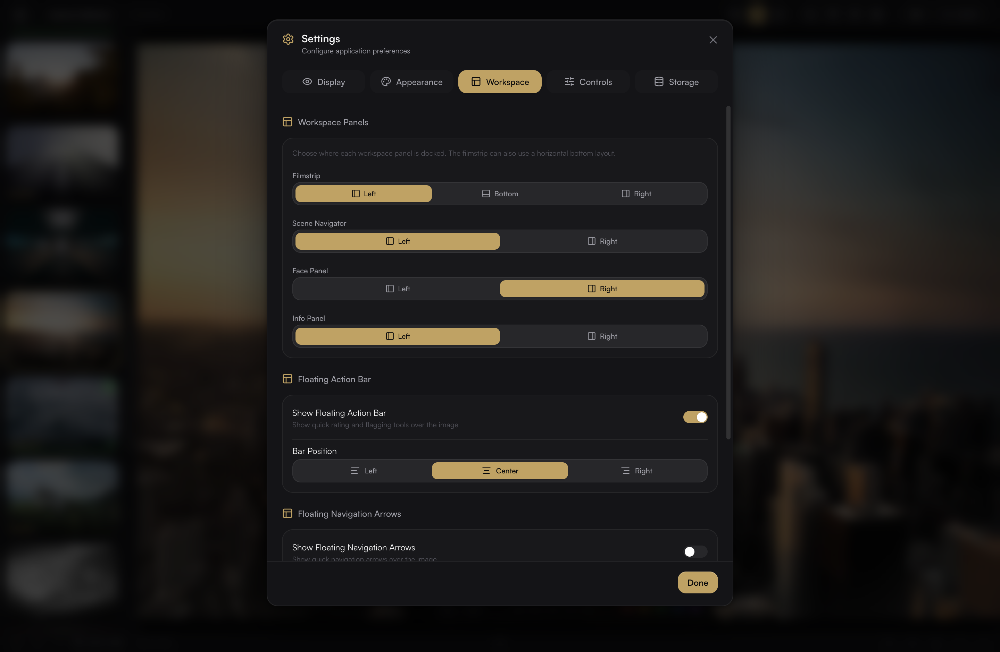

### Let the photograph fill the view

Hide the filmstrip and panels, switch off the floating controls, and hide the interface bars. Top and status bars can also auto-hide and reappear at the screen edge.


</details>

<details open>
<summary><strong>Crop, straighten, expand, and prepare removals</strong></summary>

Prepare the framing and the cleanup while you are still reviewing. Crop and level adjustments stay in metadata; Lightroom Classic generates Remove results and expanded edges.

### A workspace built for marking distractions

Brush, select, copy, paste, and group Remove marks while the filmstrip stays available. Adjust brush size, scroll resize speed, and overlay opacity; touching marks can become one removal automatically.

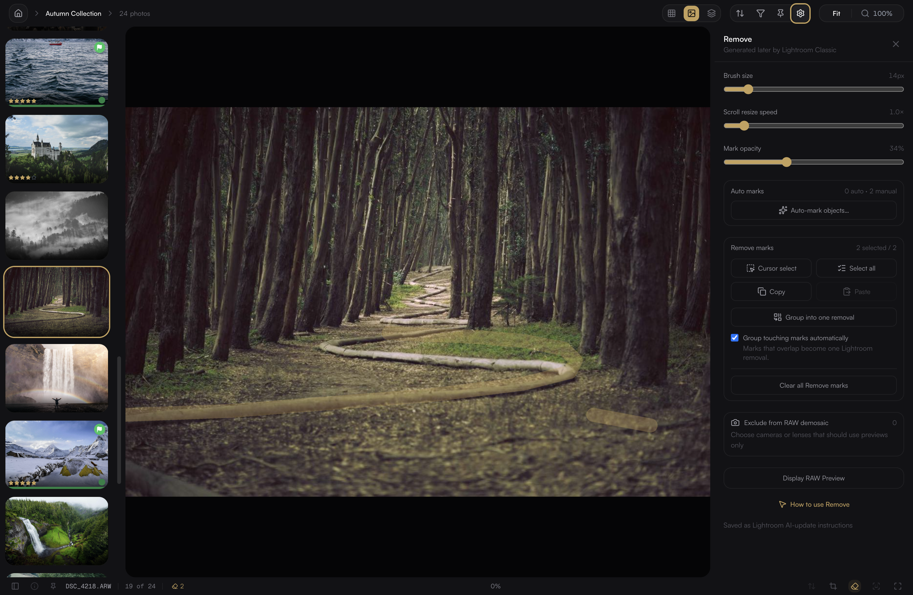

### Pan, brush, and erase without hunting for tools

Switch between Pan, Add, and Erase, or stay in Pan and use the configured modifiers to brush and erase. Resize with the wheel, pinch, or shortcuts. The in-app guide explains selection and grouping; modifiers are configurable.

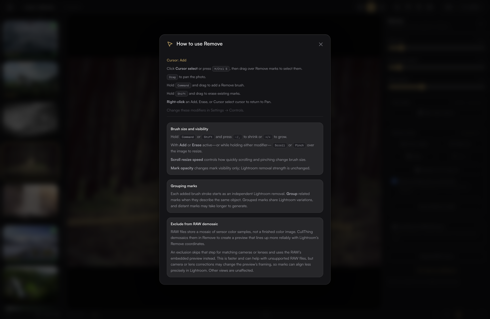

### Frame the shot before the handoff

Use aspect presets, lock the ratio, flip the orientation, and drag the crop handles with a composition grid. Apply the crop to XMP without replacing the original photo.

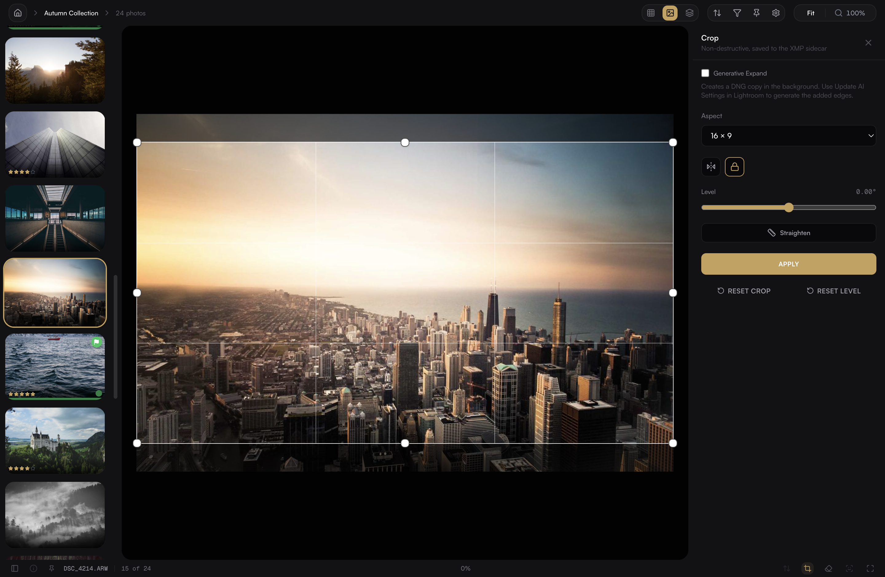

### Level the frame with room to fine-tune

Use Straighten for an automatic angle, adjust the Level slider yourself, and reset the crop and angle independently. The example shows a demo angle with the crop kept inside the rotated photo.

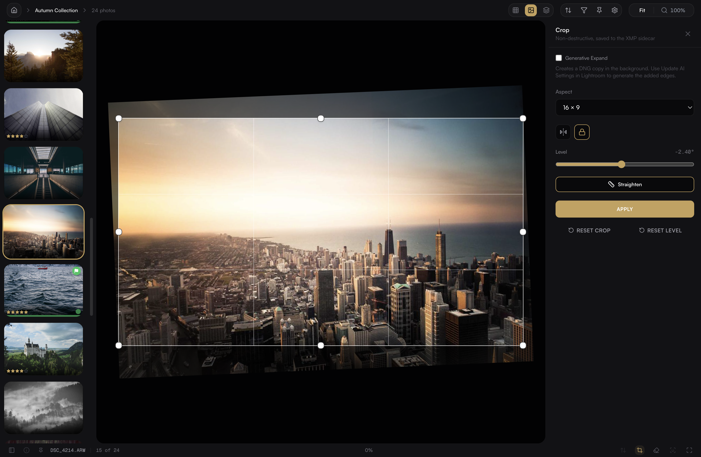

### Give the photograph more room

Extend the frame beyond the original boundaries with Generative Expand. CullThing prepares a DNG copy; use Update AI Settings in Lightroom to generate the added edges. The white border shown here is the area awaiting generation.

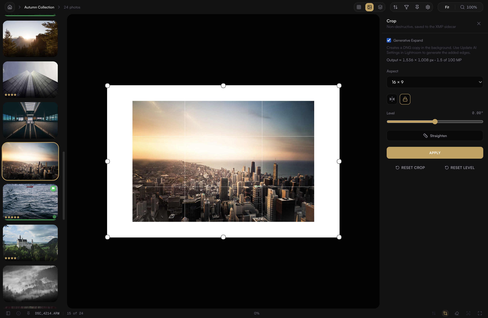

</details>

<details open>
<summary><strong>EditThing: profiles, projects, and Lightroom feedback</strong></summary>

Choose how EditThing learns your look, keep shoots organized as projects, and confirm the changes it detects from your Lightroom trial edits.

### Choose where your look comes from

Instant starts with a Lightroom preset and nine taste questions. Personal learns from your edited catalogs or RAW + XMP folders. If you are unsure, EditThing can inspect your edited photos and recommend a profile type.

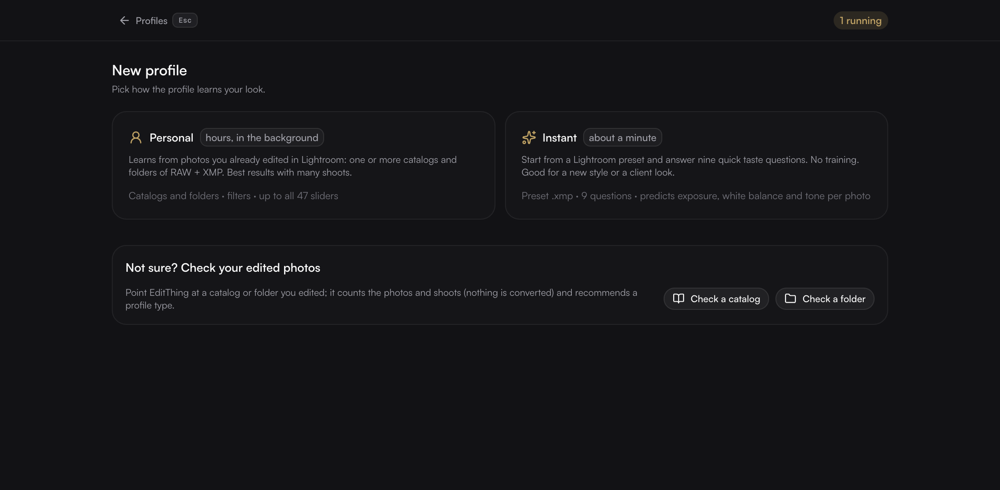

### Keep each shoot and its progress together

See the profile assigned to each project and which shoots are drafts, paused, or done. Open a project to continue editing; pause and resume work when you need to.

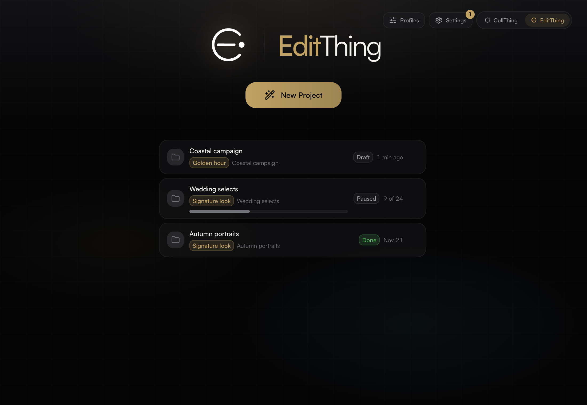

### Edit in Lightroom. Confirm what EditThing finds.

While the trial panel is open, EditThing watches the trial edits. With the Lightroom plug-in connected, it reads the changes without a separate XMP save. Consistent changes are preselected; mixed changes stay unchecked. Review the detected shifts, then confirm Save as adjustments and rewrite. This screen uses illustrative demo changes.

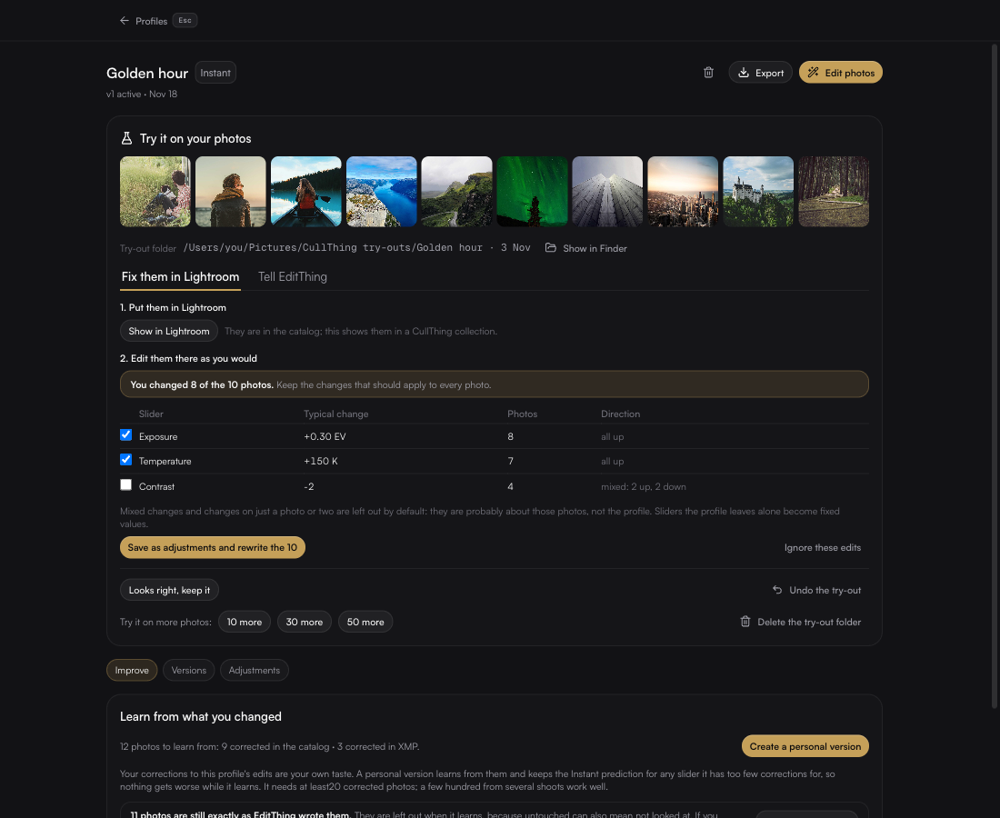

</details>

EditThing processes photos locally. First-time setup downloads its models and requires [Adobe DNG Converter](https://helpx.adobe.com/camera-raw/desktop/dng-and-file-formats/adobe-dng-converter.html). Try a profile on a small set before applying it to a shoot, then finish the photos in Lightroom Classic.

## Availability

CullThing is proprietary software currently distributed for limited testing. This public repository hosts the official installers, signed update artifacts, documentation, and website. The application source remains private; this repository's public visibility does not grant an open-source license.

## Installing on macOS

Choose the Terminal installer or install the DMG manually. The current test build is not yet notarized by Apple, so a manual install may require first-launch approval.

### Quick install with Terminal

Open **Terminal**, paste this command, and press **Return**:

```bash
curl -fsSL https://raw.githubusercontent.com/andrei930/cullthing-releases/main/install-macos.sh | /bin/bash
```

The installer downloads the latest Apple Silicon release, verifies the download, installs CullThing, and opens it. It removes quarantine **only from the CullThing copy being installed**, so no separate `xattr` command is needed.

Run it without `sudo`. It installs in `/Applications`, or `~/Applications` if needed, and keeps your existing settings. [View the installer script](install-macos.sh).

**Updating an existing copy?** If CullThing is running, quit it before using this installer.

### Install the DMG manually

1. [Download the Mac installer (.dmg)](https://github.com/andrei930/cullthing-releases/releases/download/app-v0.9.12/CullThing_0.9.12_aarch64.dmg) and open it.
2. Drag **CullThing** into the **Applications** folder, then eject the disk
   image.
3. Open CullThing from **Applications**.
4. If macOS says that `CullThing.app` was not opened, click **Done**. Do not
   click **Move to Trash**.
5. Open **System Settings**, select **Privacy & Security**, and scroll down to
   the **Security** section.
6. Click **Open Anyway** beside the message about CullThing, authenticate, and
   confirm **Open**.

The **Open Anyway** button is available for about an hour after a blocked
launch attempt. After this approval, macOS saves CullThing as an exception and
it can be opened normally. See
[Apple's official instructions](https://support.apple.com/guide/mac-help/open-a-mac-app-from-an-unknown-developer-mh40616/mac)
for more information.

If the button is not present, try opening CullThing from **Applications** once more and immediately return to **Privacy & Security**, or use the quick-install helper above. Only approve or run a copy from this official repository.

## Installing on Windows

1. [Download the Windows installer (.exe)](https://github.com/andrei930/cullthing-releases/releases/download/app-v0.9.12/CullThing_0.9.12_x64-setup.exe) and run it.
2. Follow the installer to install CullThing for your Windows account.

The current test build is not Authenticode-signed. If Microsoft Defender SmartScreen displays a warning, select **More info**, verify that the app is CullThing, and choose **Run anyway**.

## Updates

Updater-enabled versions of CullThing check this repository for newer
published releases. CullThing displays an in-app prompt before downloading and
installing an update, and it relaunches after installation. A manual
**Check for Updates** command is also available from the application menu.

The updater validates a separate cryptographic signature before accepting an
update. This protects the update channel from modified or unauthorized
artifacts, but it is independent of Apple notarization and Microsoft
Authenticode signing. Draft releases are never offered through the updater.

## Licensing

CullThing itself is proprietary and all rights are reserved. Third-party
components remain governed by their own licenses and notices. See
[PROPRIETARY-NOTICE.md](PROPRIETARY-NOTICE.md) and
[RAWLER-LGPL-WRITTEN-OFFER.md](RAWLER-LGPL-WRITTEN-OFFER.md).

Requests for the LGPL materials described in the written offer can be made
through the repository's [Issues](https://github.com/andrei930/cullthing-releases/issues)
page. The LGPL offer covers the applicable `rawler` materials and relinking
support; it does not make CullThing's proprietary source code open source.
