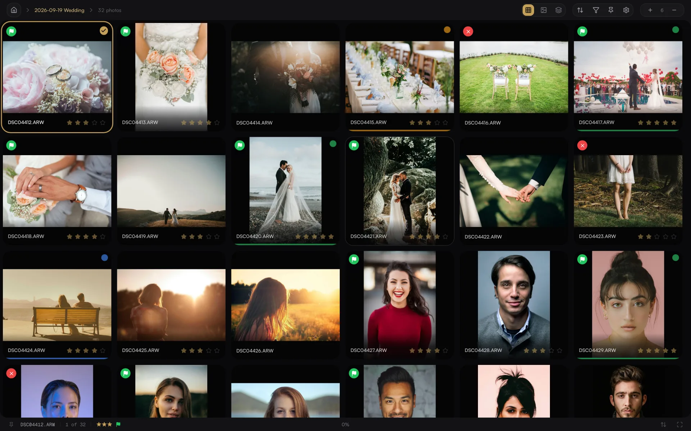

# CullThing

Everything you do before Lightroom Classic, in one fast app. Go through a shoot scene by scene, check faces and focus, and rate from the keyboard. Brush out distractions while you cull, and Lightroom generates every removal in one batch instead of making you wait on each photo.

**[Website and tour](https://andrei930.github.io/cullthing-releases/)** · [Release notes](https://github.com/andrei930/cullthing-releases/releases) · [Report an issue](https://github.com/andrei930/cullthing-releases/issues)



## Download

**Current release: [CullThing v0.9.12](https://github.com/andrei930/cullthing-releases/releases/latest)**

| Platform    | Installer                                                                                                                                       | Requirements                       |
| ----------- | ----------------------------------------------------------------------------------------------------------------------------------------------- | ---------------------------------- |
| **macOS**   | **[Download for Mac (.dmg)](https://github.com/andrei930/cullthing-releases/releases/download/app-v0.9.12/CullThing_0.9.12_aarch64.dmg)**       | Apple Silicon, macOS 13.4 or later |
| **Windows** | **[Download for Windows (.exe)](https://github.com/andrei930/cullthing-releases/releases/download/app-v0.9.12/CullThing_0.9.12_x64-setup.exe)** | 64-bit Intel/AMD                   |

These are test builds and aren't signed yet, so macOS and Windows warn the first time you open CullThing. The [Mac](#installing-on-macos) and [Windows](#installing-on-windows) steps below explain what to do. On a Mac, the [Terminal installer](#quick-install-with-terminal) handles it for you.

Already installed? Choose **Check for Updates…** in the app menu.

Files ending in `.app.tar.gz` and `.sig`, and `latest.json`, are for the updater, not for installing. Download CullThing only from this repository.

## What it does

### Culling

- **Scenes.** The shoot is grouped into scenes wherever there's a gap between shots. Change the gap (2 seconds to 5 minutes), add visual similarity, cap the photos per scene, or split by lens, camera body, folder or orientation.
- **Faces, eyes and focus.** The face panel shows each face enlarged with a focus score from 1 to 10. Analyze Eyes marks eyes as open, partly closed or closed. The zoom key jumps to the sharpest face or the camera's focus point and stays there as you step through a burst.
- **Camera clocks.** Align Timelines puts each camera body on its own lane so you can drag, nudge or let Suggest line up the moments. Sync from one shared moment, type an offset, or reuse saved offsets from the Clock library.
- **Fast, and laid out your way.** The next photo is prepared before you get to it. Every panel can be resized, moved to either side or hidden.
- **Keys and mouse.** The default keys follow Lightroom (0–5 stars, P/X/U flags, 6–9 color labels) and every shortcut can be changed. The mouse's back and forward buttons and the scroll wheel are configurable too.

### Remove, in one batch

In Lightroom Classic, Generative Remove makes you wait on each photo. In CullThing you brush distractions while you cull, and the marks are saved as Lightroom Remove instructions in each photo's XMP. In Lightroom you select the shoot and choose **Update AI Settings** once, and it generates every removal in one batch.

Auto-mark can add the marks for you: wires and cables, exit signs, power outlets and other common objects, or anything you type. Suggestions stay out of Lightroom until you accept them, and auto-mark never changes marks you painted yourself.

### How it fits with Lightroom Classic

1. Copy the cards with Card Manager.
2. Cull in CullThing. Ratings, color labels, crops, angles and Remove marks are saved to XMP next to each RAW.
3. Start the edit with EditThing, which writes develop settings to the XMP, or into an open catalog with the Lightroom plug-in.
4. Import the folder into Lightroom, or choose **Metadata → Read Metadata from Files** if it's already in your catalog.
5. Select the shoot and choose **Update AI Settings**. Removals and Generative Expand edges are generated in one batch.

### EditThing

A free first edit in your style that runs on your computer. Build a Personal profile from photos you've already edited, or an Instant profile from a Lightroom preset and nine questions. Try it on about 10 copies and fix them in Lightroom; EditThing saves the changes you made consistently as adjustments to the profile. Repeat until it looks like your work, then apply it to the shoot. EditThing needs [Adobe DNG Converter](https://helpx.adobe.com/camera-raw/desktop/dng-and-file-formats/adobe-dng-converter.html) and downloads its models during first-time setup.

### Also

Cull from a phone or tablet with Remote Access, check coverage with Folder Stats, and find a photo by filename with **⌘F / Ctrl+F**.

Screenshots use sample photos from Unsplash and Lorem Picsum, plus one AI-generated burst. See [SCREENSHOTS.md](SCREENSHOTS.md).

## Availability

CullThing is proprietary software currently distributed for limited testing. This public repository hosts the official installers, signed update artifacts, documentation, and website. The application source remains private; this repository's public visibility does not grant an open-source license.

## Installing on macOS

Choose the Terminal installer or install the DMG manually. The current test build is not yet notarized by Apple, so a manual install may require first-launch approval.

### Quick install with Terminal

Open **Terminal**, paste this command, and press **Return**:

```bash
curl -fsSL https://raw.githubusercontent.com/andrei930/cullthing-releases/main/install-macos.sh | /bin/bash
```

The installer downloads the latest Apple Silicon release, verifies the download, installs CullThing, and opens it. It removes quarantine **only from the CullThing copy being installed**, so no separate `xattr` command is needed.

Run it without `sudo`. It installs in `/Applications`, or `~/Applications` if needed, and keeps your existing settings. [View the installer script](install-macos.sh).

**Updating an existing copy?** If CullThing is running, quit it before using this installer.

### Install the DMG manually

1. [Download the Mac installer (.dmg)](https://github.com/andrei930/cullthing-releases/releases/download/app-v0.9.12/CullThing_0.9.12_aarch64.dmg) and open it.
2. Drag **CullThing** into the **Applications** folder, then eject the disk
   image.
3. Open CullThing from **Applications**.
4. If macOS says that `CullThing.app` was not opened, click **Done**. Do not
   click **Move to Trash**.
5. Open **System Settings**, select **Privacy & Security**, and scroll down to
   the **Security** section.
6. Click **Open Anyway** beside the message about CullThing, authenticate, and
   confirm **Open**.

The **Open Anyway** button is available for about an hour after a blocked
launch attempt. After this approval, macOS saves CullThing as an exception and
it can be opened normally. See
[Apple's official instructions](https://support.apple.com/guide/mac-help/open-a-mac-app-from-an-unknown-developer-mh40616/mac)
for more information.

If the button is not present, try opening CullThing from **Applications** once more and immediately return to **Privacy & Security**, or use the quick-install helper above. Only approve or run a copy from this official repository.

## Installing on Windows

1. [Download the Windows installer (.exe)](https://github.com/andrei930/cullthing-releases/releases/download/app-v0.9.12/CullThing_0.9.12_x64-setup.exe) and run it.
2. Follow the installer to install CullThing for your Windows account.

The current test build is not Authenticode-signed. If Microsoft Defender SmartScreen displays a warning, select **More info**, verify that the app is CullThing, and choose **Run anyway**.

## Updates

Updater-enabled versions of CullThing check this repository for newer
published releases. CullThing displays an in-app prompt before downloading and
installing an update, and it relaunches after installation. A manual
**Check for Updates** command is also available from the application menu.

The updater validates a separate cryptographic signature before accepting an
update. This protects the update channel from modified or unauthorized
artifacts, but it is independent of Apple notarization and Microsoft
Authenticode signing. Draft releases are never offered through the updater.

## Licensing

CullThing itself is proprietary and all rights are reserved. Third-party
components remain governed by their own licenses and notices. See
[PROPRIETARY-NOTICE.md](PROPRIETARY-NOTICE.md) and
[RAWLER-LGPL-WRITTEN-OFFER.md](RAWLER-LGPL-WRITTEN-OFFER.md).

Requests for the LGPL materials described in the written offer can be made
through the repository's [Issues](https://github.com/andrei930/cullthing-releases/issues)
page. The LGPL offer covers the applicable `rawler` materials and relinking
support; it does not make CullThing's proprietary source code open source.
