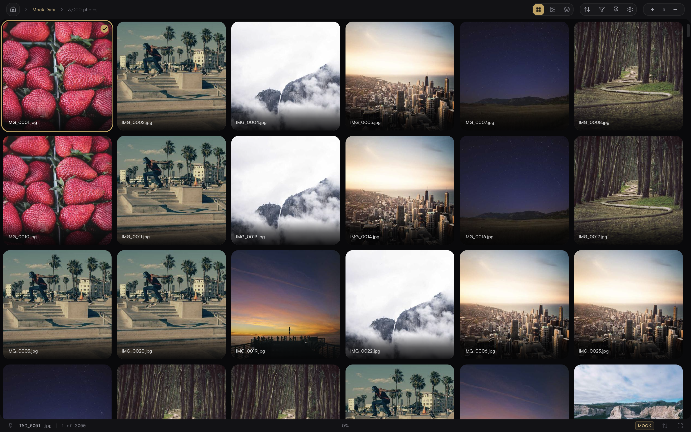
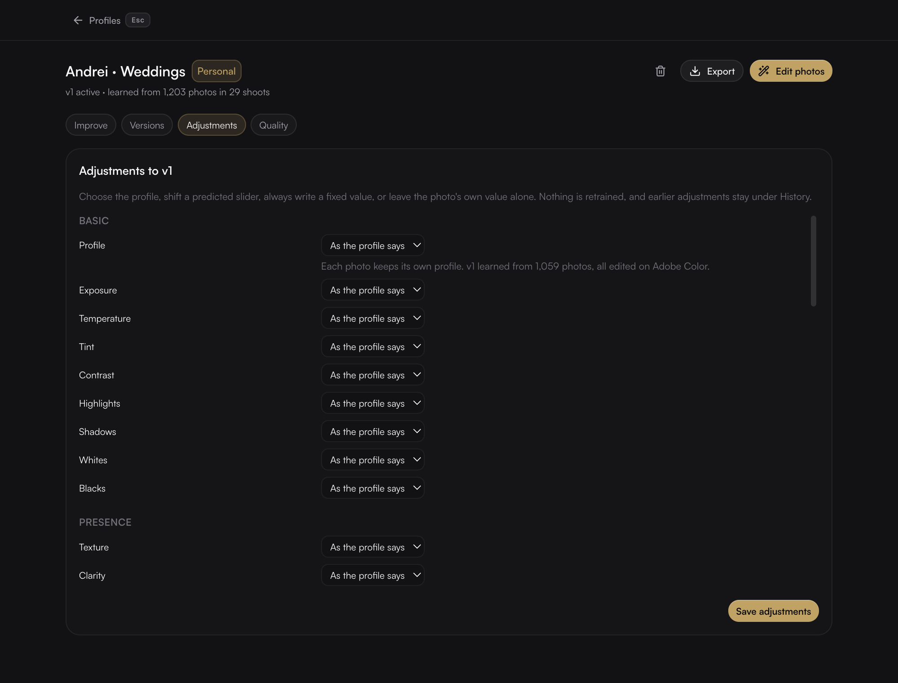

# CullThing

**From memory card to selects, edits, and Lightroom.**

CullThing is a desktop app for photographers working through large RAW shoots. Review photos by scene, find your keepers, prepare Remove adjustments, and give a whole shoot a starting edit with EditThing.

**[Visit the CullThing website](https://andrei930.github.io/cullthing-releases/)** · [Latest release & notes](https://github.com/andrei930/cullthing-releases/releases/latest) · [Report an issue](https://github.com/andrei930/cullthing-releases/issues)



_The real CullThing interface, captured in demo mode with sample photos. No personal photo library is shown._

## Download and install

| Platform    | Latest installer                                                                                      | Requirements                                      |
| ----------- | ----------------------------------------------------------------------------------------------------- | ------------------------------------------------- |
| **macOS**   | **[Download for Mac](https://andrei930.github.io/cullthing-releases/download/?platform=macos)**       | Apple Silicon (M1 or newer), macOS 13.4+ · `.dmg` |
| **Windows** | **[Download for Windows](https://andrei930.github.io/cullthing-releases/download/?platform=windows)** | 64-bit Intel/AMD · `x64-setup.exe`                |

These links look up the latest published stable release and open the matching installer. If a download cannot start, use the **[latest release page](https://github.com/andrei930/cullthing-releases/releases/latest)** and select the `.dmg` or `x64-setup.exe`. Intel Macs and Windows ARM builds are not currently provided.

1. **Download** the installer for your computer.
2. **Install** using the [macOS instructions](#installing-on-macos) or [Windows instructions](#installing-on-windows) below. Current test builds may show an operating-system security warning; the steps below explain what to expect.
3. **Open a folder** of photos to start culling, or choose **EditThing** on the home screen to set up an editing profile.

Already installed? Use **Check for Updates…** in the application menu.

Files ending in `.app.tar.gz`, `.sig`, and `latest.json` belong to the updater, not a normal installation. Download only from this official repository or a link supplied directly by the developer. Draft releases are still being tested.

## More than culling

- **Review your way.** Switch between a photo grid, scenes, and a single-image view. Navigate with the keyboard, compare similar frames, and inspect faces, focus, and eye status.
- **Make your selects.** Use star ratings, color labels, pick/reject flags, filters, and sorting. Find a specific file with **⌘F / Ctrl+F**. Keep culling decisions alongside your photos in XMP sidecars.
- **Crop and straighten.** Set framing and leveling before you continue in Lightroom Classic, with adjustments saved as metadata.
- **Prepare removals.** Brush over distractions in **Remove mode**, use auto-mark suggestions, copy marks between photos, and group touching marks into one removal. CullThing saves Lightroom-compatible AI-update instructions; **Lightroom Classic generates the removal result**.
- **Edit a shoot with EditThing.** Start from a Lightroom preset with an **Instant** profile, or train a **Personal** profile from your own edited photos. Try a profile on a few images, apply it across a shoot, adjust its behavior, and undo an edit run.
- **Bring in your cards.** **Card Manager** lets you review and copy photos from memory cards to your chosen destinations.
- **Cull from another device.** Enable **Remote Access** on the desktop, then pair a phone or tablet on the same network to review a project or the library in its browser.
- **Continue in Lightroom Classic.** Carry ratings, labels, crops, and Remove instructions through XMP. EditThing can write develop settings to sidecars or work with an open catalog through the included Lightroom Classic plug-in.

## Meet EditThing



_EditThing's profile adjustments, shown with illustrative demo data._

An **Instant** profile combines a Lightroom `.xmp` preset with a short questionnaire about your editing preferences. A **Personal** profile learns from photos you have already edited in Lightroom Classic catalogs or RAW folders with XMP sidecars.

EditThing processes photos locally. First-time setup downloads its models and requires [Adobe DNG Converter](https://helpx.adobe.com/camera-raw/desktop/dng-and-file-formats/adobe-dng-converter.html). You can preview a profile on a small set before applying it to a shoot, then finish the photos in Lightroom Classic.

## Availability

CullThing is proprietary software currently distributed for limited testing. This public repository hosts the official installers, signed update artifacts, documentation, and website. The application source remains private; this repository's public visibility does not grant an open-source license.

## Installing on macOS

The current macOS build is ad-hoc signed but is not yet notarized by Apple.
Consequently, macOS shows a warning the first time CullThing is installed.

1. Open the downloaded `.dmg` file.
2. Drag **CullThing** into the **Applications** folder, then eject the disk
   image.
3. Open CullThing from **Applications**.
4. If macOS says that `CullThing.app` was not opened, click **Done**. Do not
   click **Move to Trash**.
5. Open **System Settings**, select **Privacy & Security**, and scroll down to
   the **Security** section.
6. Click **Open Anyway** beside the message about CullThing, authenticate, and
   confirm **Open**.

The **Open Anyway** button is available for about an hour after a blocked
launch attempt. After this approval, macOS saves CullThing as an exception and
it can be opened normally. See
[Apple's official instructions](https://support.apple.com/guide/mac-help/open-a-mac-app-from-an-unknown-developer-mh40616/mac)
for more information.

If the button is not present, try opening CullThing from **Applications** once
more and immediately return to **Privacy & Security**. As a last-resort
fallback, remove the quarantine attribute from this specific installation:

```bash
xattr -dr com.apple.quarantine /Applications/CullThing.app
```

Only use either override when CullThing was downloaded from this official
repository or received directly from the developer.

## Installing on Windows

The current Windows build is not Authenticode-signed. If Microsoft Defender
SmartScreen displays a warning, select **More info**, verify that the app is
CullThing, and choose **Run anyway**. The installer operates for the current
Windows user and does not require a system-wide installation.

## Updates

Updater-enabled versions of CullThing check this repository for newer
published releases. CullThing displays an in-app prompt before downloading and
installing an update, and it relaunches after installation. A manual
**Check for Updates** command is also available from the application menu.

The updater validates a separate cryptographic signature before accepting an
update. This protects the update channel from modified or unauthorized
artifacts, but it is independent of Apple notarization and Microsoft
Authenticode signing. Draft releases are never offered through the updater.

## Licensing

CullThing itself is proprietary and all rights are reserved. Third-party
components remain governed by their own licenses and notices. See
[PROPRIETARY-NOTICE.md](PROPRIETARY-NOTICE.md) and
[RAWLER-LGPL-WRITTEN-OFFER.md](RAWLER-LGPL-WRITTEN-OFFER.md).

Requests for the LGPL materials described in the written offer can be made
through the repository's [Issues](https://github.com/andrei930/cullthing-releases/issues)
page. The LGPL offer covers the applicable `rawler` materials and relinking
support; it does not make CullThing's proprietary source code open source.
